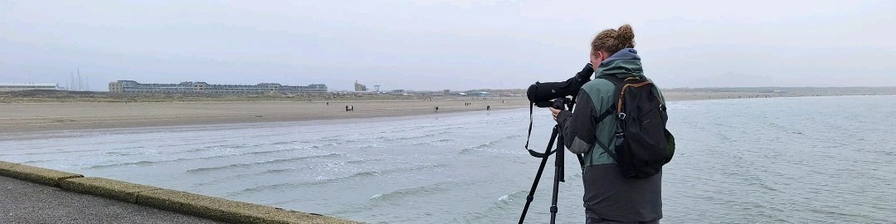

## Side Quests

### Bananas

...

### Binary puzzles

...

## Hobbies

### Puzzles

As one might guess based on the side quest above, I love doing puzzles. While I have had a brief jigsaw period, my go-to puzzles are mostly logic and number-based. Think sudoku, except sudokus are my least favourite in this genre of puzzles. My favourites are "binary" puzzles and "tectonic". At the time of writing I have subscriptions to three different types of puzzle books, and I always carry a few books in my bag in case I have a spare moment. If provoked, I will happily talk binary puzzle or tectonic strategy; I'm always curious about new solving strategies.

### Reading

Reading is one of my oldest hobbies, though it fluctuates in how active it is. Some years I read one book, while in 2026 I'm approaching fifty. Some of my favourite genres are contemporary literary fiction (with the occasional touch of magical realism), classics, queer romance, and, recently, a little bit of fantasy. I also like the idea of non-fiction, but my attention span tends to struggle with those.

### Knitting and crochet

I picked up knitting and crochet in the pandemic. Since then I've made many plushes, hats, a scarf, a jumper, house slippers, three and a half socks, and many other things in various states of completion. I haven't done it as much in the last year or two, but occasionally, when life is (not) too busy or I need a gift for someone, I'll pick it up again for a few weeks. 

### Bird watching

Whenever I'm outside --- or close to a window --- you can catch me scanning for birds. I enjoy looking at whatever birds are around, but my favourites are shorebirds and ducks. Put me and my telescope near a mudflat with foraging birds and I'm entertained for the rest of the day (at least until the tide comes in and the birds move inland). Though I know most of the common birds around The Netherlands by appearance, do not ask me about their sounds; I could probably recognise ten species at best.

### Running and cycling

Early 2025 I discovered that cycling can be fun, and not just a mode of transport. In 2025 I cycled 2000km (for fun!), but since I picked up running it's been more on the back burner. I started running late 2025 and I haven't looked back. Mostly on the road, with the occasional trail thrown in. Since then I've run a few 10K events and signed up for an 18km trail and a half marathon. Wish me luck!